# Active Directory Help Desk and Automation Lab

A Windows Server 2022 domain with a Windows 11 client, built from scratch in VMware. I automated bulk user creation with PowerShell and set up DHCP, DNS, NAT, shared folders, and Group Policy, then used the environment to practice real help desk ticket work.

## Scenario

I play the IT person at a 150-person company. I build the domain, create the staff accounts, give everyone internet access through the server, and then handle the kind of account and access tickets a help desk sees every week.

## Tools

VMware Workstation Pro, Windows Server 2022 (evaluation), Windows 11 Enterprise (evaluation), PowerShell, Active Directory Users and Computers, DHCP, DNS, Routing and Remote Access (NAT), Group Policy Management.

## Lab design

| | DC01 | CLIENT01 |
|---|---|---|
| OS | Windows Server 2022 Standard (Desktop Experience) | Windows 11 Enterprise |
| Resources | 2 vCPU, 4 GB RAM, 60 GB disk | 2 vCPU, 4 GB RAM, 60 GB disk |
| Network | Internal NIC on VMnet2 (192.168.50.10), External NIC on NAT | One NIC on VMnet2, address from DHCP |
| Roles | AD DS, DNS, DHCP, RRAS (NAT) | Domain member |

Domain: `corp.local`. Internal network: `192.168.50.0/24`. VMware's built-in DHCP is turned off on VMnet2 so that DC01 is the only DHCP server, as in a real office.

*VMnet2 is host-only with VMware's DHCP disabled, so DC01 controls addressing.*

*DC01 has two adapters: one on the private network, one on NAT for internet access.*

*CLIENT01 sits only on the private network, so its internet access has to go through DC01.*

## What I built

### 1. Domain controller, DHCP, and NAT
I installed AD DS, DNS, and DHCP on DC01 and promoted it to a domain controller for a new forest, `corp.local`. I added a DNS forwarder so the lab can resolve internet names, created the DHCP scope `LabScope` (192.168.50.100 to 150), and set up NAT in RRAS so clients reach the internet through DC01.

### 2. Company structure and bulk user creation
I created an OU structure (Corp, with Users split into Sales, IT, HR, Finance, and Operations, plus Computers, Groups, and Disabled) and six security groups. I created three users by hand to learn the fields, then wrote a PowerShell script that reads a CSV and creates 150 users in their department OUs and adds each to the matching security group.

*The CSV holds one row per employee: first name, last name, logon name, and department.*

*The script wrapped in `Measure-Command`: 150 accounts created in about 20.7 seconds.*

*The department OUs filled with users after the script ran.*

### 3. Joining the client and testing the network
CLIENT01 received its address from DC01's DHCP server, resolved `corp.local` through DC01's DNS, reached the internet through NAT, and joined the domain. I moved its computer account from the default Computers container into the Corp > Computers OU so Group Policy can target it, then signed in as a domain user.

*CLIENT01's lease from DC01: address in the scope, gateway and DNS pointing at DC01.*

*`nslookup corp.local` resolves to DC01 and the ping to 8.8.8.8 succeeds through NAT.*

*The lease for CLIENT01 as seen on the DHCP server.*

*CLIENT01's computer account in the Corp > Computers OU after joining the domain.*

*A domain user created on DC01 signing in on CLIENT01.*

### 4. Shared folder and group-based access
I created a Sales share with Everyone: Full Control at the share level and NTFS Modify for `SG-Sales` only, with the default Users entries removed. Access is controlled by group membership, never by individual user.

*Only SG-Sales (Modify), Administrators, SYSTEM, and CREATOR OWNER have access.*

*Jane (Sales) opens the share and creates a file.*

*Mark (IT) gets "Access denied" on the same share.*

### 5. Group Policy
I created three GPOs: a password and lockout policy linked at the domain level, a mapped Sales drive linked to the Sales OU, and a password-protected screen saver timeout linked to the Users OU. I verified them on CLIENT01 with `gpupdate /force` and `gpresult`.

*Minimum length 10, maximum age 90 days, lockout after 5 failed attempts.*

*Jane gets the S: drive because her account is in the Sales OU.*

*`gpresult` showing the user policies that applied to Jane.*

*`gpresult` computer scope showing the domain-level policies applied to CLIENT01.*

*Mark gets the screen saver policy but not the Sales drive, because he is in the IT OU.*

## Results

- 150 users created, placed in department OUs, and added to security groups in about 20.7 seconds with one script
- Sales share accessible to a Sales user and denied to an IT user through group membership alone
- Three GPOs applied and verified with `gpresult`, with different results for users in different OUs

## Troubleshooting I did

**Windows Server setup stopped with "Windows cannot find the Microsoft Software License Terms."**
Cause: VMware's Easy Install was feeding Setup an answer file that didn't work with the evaluation ISO. Fix: removed the virtual floppy and ran Setup manually.

**`SG-Sales` showed 33 members instead of the expected 31.**
Cause: two manually created users (Mark and Priya) had been created in the Sales OU instead of IT and HR. I found them by comparing the group against the source CSV. Fix: moved them to the correct OUs, corrected their group membership, and re-checked the counts (31 each).

*Comparing group members against the CSV exposed the extra accounts.*

*Group counts back to the expected 31 after the fix.*

**CLIENT01 had an IP address but no default gateway, so it couldn't reach the internet.**
Cause: the DHCP scope had no router option (003), and there were leftover WINS options (044 and 046) pointing at an unreachable address. Fix: added option 003 pointing at DC01, removed the WINS options, and renewed the lease.

**`nslookup corp.local` returned a second, unreachable address.**
Cause: DC01's NAT adapter was registering its own address in DNS. Fix: turned off DNS registration on the External adapter and removed the stray records.

## Notes

- The passwords in the script (`Welcome#2026`) are fake lab values. In a real environment I would never store a password in a script.
- All software is free evaluation editions, used in an isolated lab.

## More troubleshooting I did

**The lockout policy never triggered.**
Symptom: after dozens of wrong passwords, `BadLogonCount` reached 16 but the account never locked. `Get-ADDefaultDomainPasswordPolicy` showed `LockoutThreshold 0` and `MinPasswordLength 7`, not the values in my GPO. Cause: the Default Domain Policy had Link Order 1 and my password GPO had Link Order 2, so the Default Domain Policy won. Fix: moved my GPO to Link Order 1, and the effective policy became threshold 5, minimum length 10. After that the lockout worked.

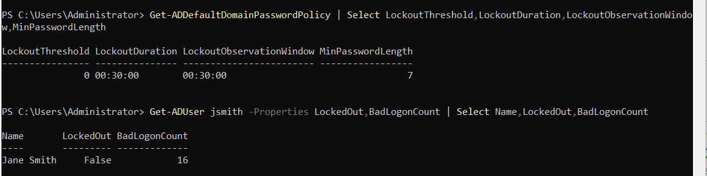

*Effective policy before the fix: threshold 0, minimum length 7.*

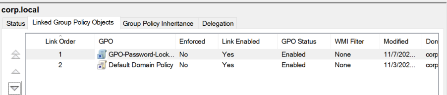

*My GPO moved to Link Order 1.*

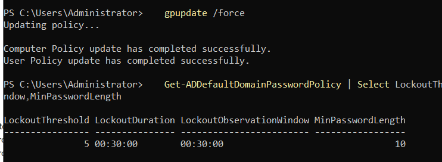

*Effective policy after the fix: threshold 5, minimum length 10.*

**Windows 11 showed "Invalid credentials, delaying next attempt" during the lockout test.**
Cause: Windows 11 slows repeated failed sign-ins on the PC itself, which is separate from the domain lockout. Fix: I produced the failed attempts with `net use` against DC01 instead of the sign-in screen, so the bad passwords still counted against the domain policy.

*The client-side sign-in delay message.*

### 6. Help desk tickets

I worked six tickets in the lab. Each has a before and after state.

**Ticket 1: Password reset with forced change.** A user in HR forgot her password. I reset it in ADUC with "User must change password at next logon", so only she knows the final password. The `PasswordLastSet` timestamp changed, and CLIENT01 forced a password change at her next sign-in.

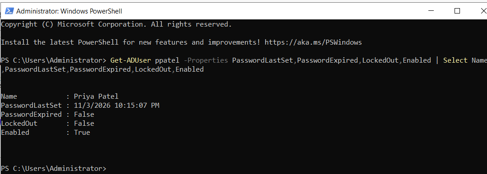

*`PasswordLastSet` before the reset.*

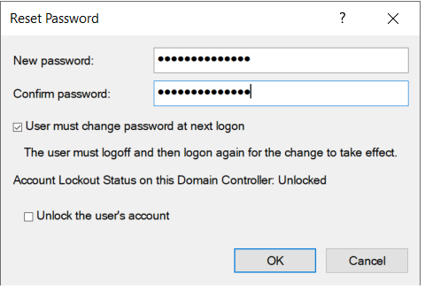

*The reset with forced change ticked.*

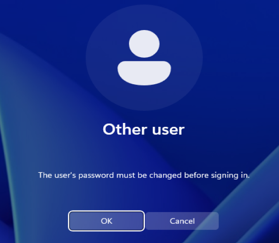

*CLIENT01 requiring a new password at sign-in.*

**Ticket 2: Locked-out user.** A Sales user was locked out after repeated wrong passwords. I confirmed `LockedOut = True` with `Get-ADUser`, unlocked the account with `Unlock-ADAccount`, and confirmed she could sign in again. In a real ticket I would verify the caller's identity first.

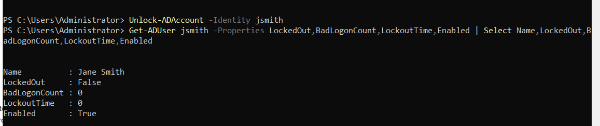

*`Unlock-ADAccount` run, then `LockedOut: False`.*

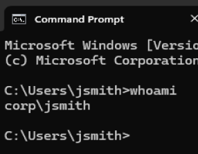

*The user signed in again on CLIENT01.*

**Ticket 3: Onboard a new hire.** I created the account in the Sales OU with a temporary password and forced change, added the user to `SG-Sales`, and tested as the new user. The S: drive mapped (from the OU) and he could create a file in the share (from the group).

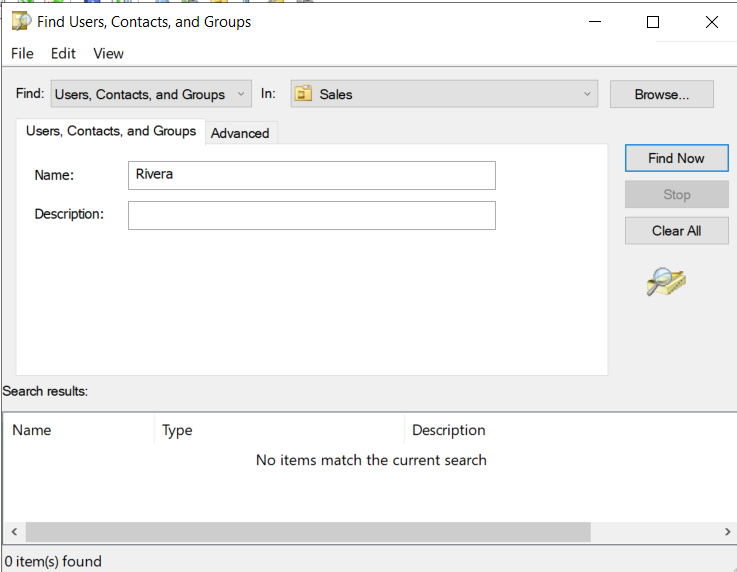

*Searching for the user before creating the account returns nothing.*

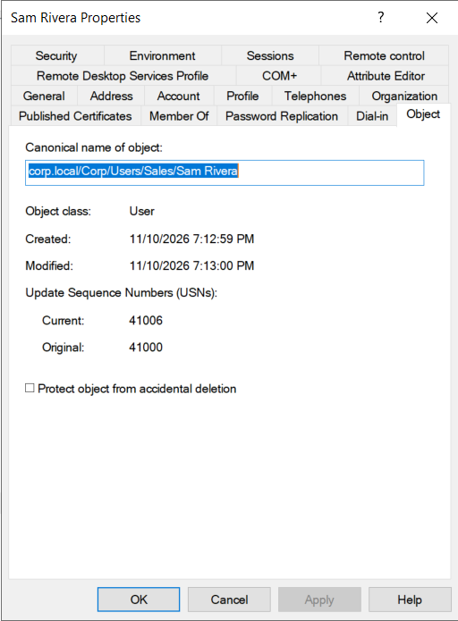

*The new user in the Sales OU and a member of `SG-Sales`.*

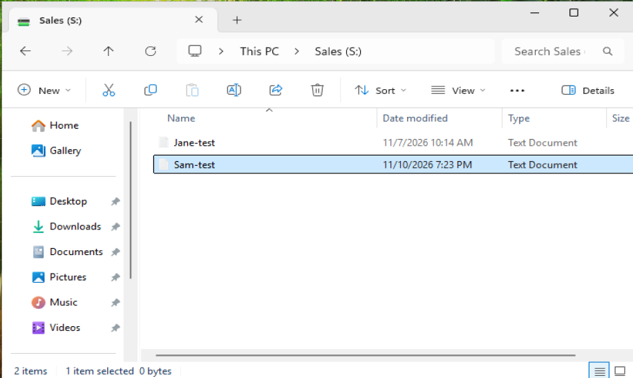

*The new hire opens the S: drive and creates a file.*

**Ticket 4: Offboard a leaver.** I disabled the account first, removed his group membership, and moved him to the Disabled OU. I did not delete him, because the company may need his account or files later. His sign-in was blocked afterwards.

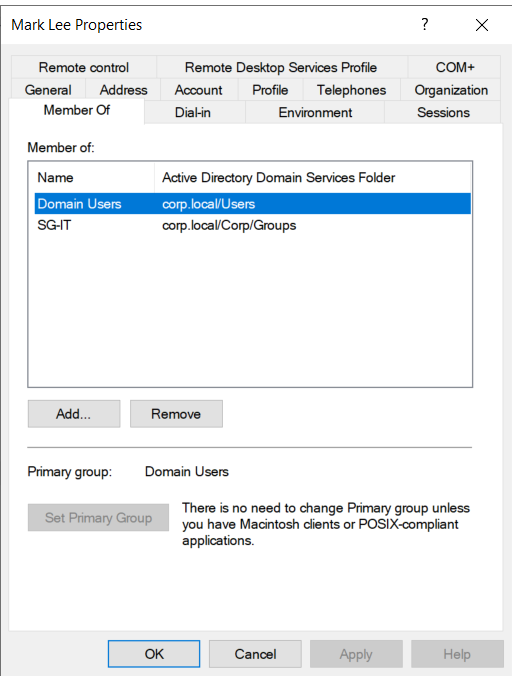

*Group membership before offboarding.*

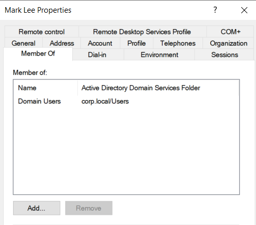

*Only Domain Users remains.*

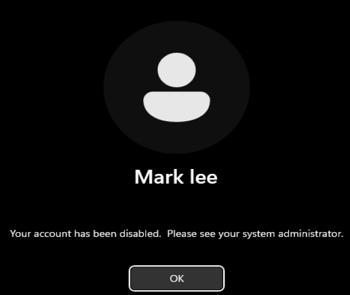

*The sign-in attempt on CLIENT01 is blocked.*

**Ticket 5: "Access denied" on a shared folder.** An HR user needed the Sales folder, and her manager had approved it. She was denied because her groups didn't include `SG-Sales`. I fixed it by adding her to the group instead of changing folder permissions, and she needed a fresh sign-in before her access token updated.

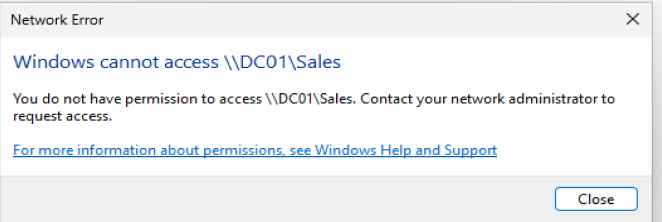

*Access denied on `\\DC01\Sales`.*

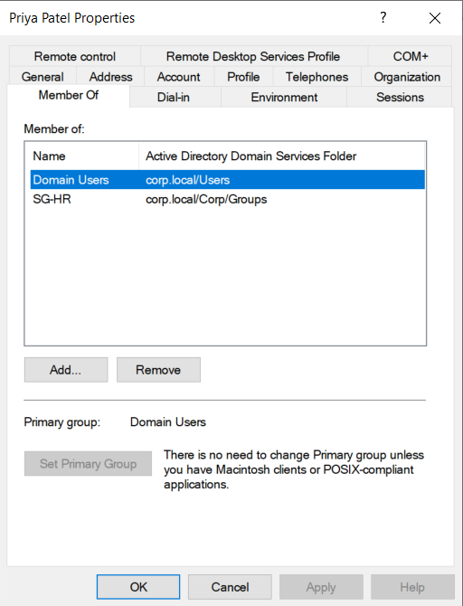

*Member Of shows only `SG-HR`.*

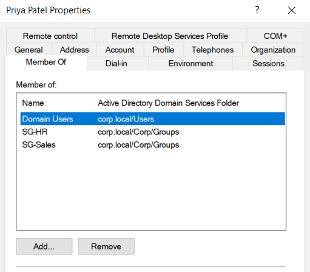

*Member Of now includes `SG-Sales`.*

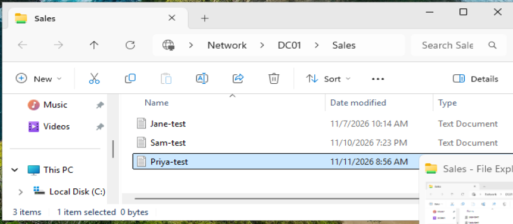

*The share opens and she creates a file.*

**Ticket 6: Delegation of Control for the help desk.** I created a help desk user in `SG-HelpDesk` and delegated password reset and unlock permissions on the Users OU to that group, so help desk staff don't need domain admin rights. As the help desk user, I reset a password successfully. Creating users was not available to the account (the New > User option didn't appear), and deleting a user returned "Access denied". I did not test the unlock permission.

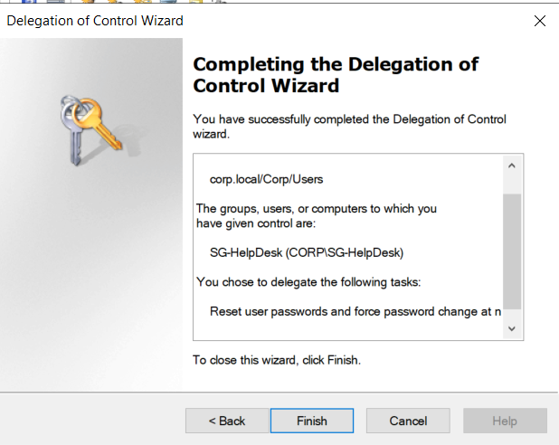

*The wizard summary showing `SG-HelpDesk` and the delegated task.*

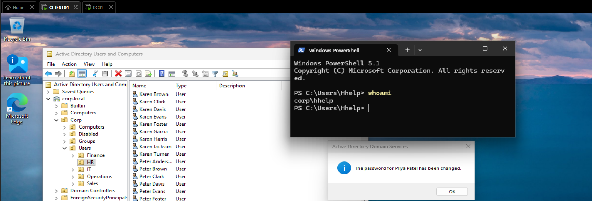

*The help desk account resets a password.*

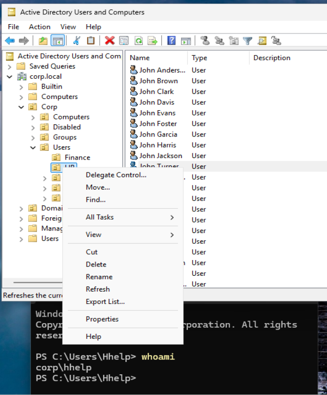

*The New > User option is not available to the help desk account.*

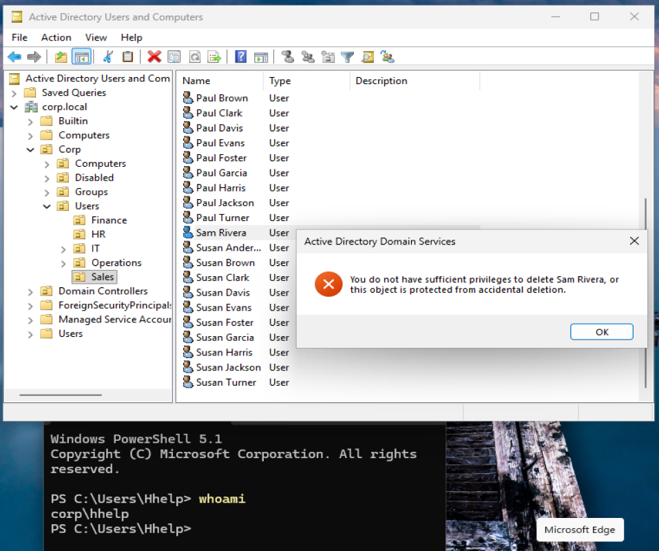

*Deleting a user returns Access denied.*

## Results 

- 150 users created in about 20.7 seconds with one script
- Six help desk tickets completed with before and after evidence
- Least privilege shown twice: group-based folder access and a delegated help desk role that could reset passwords but not delete accounts
